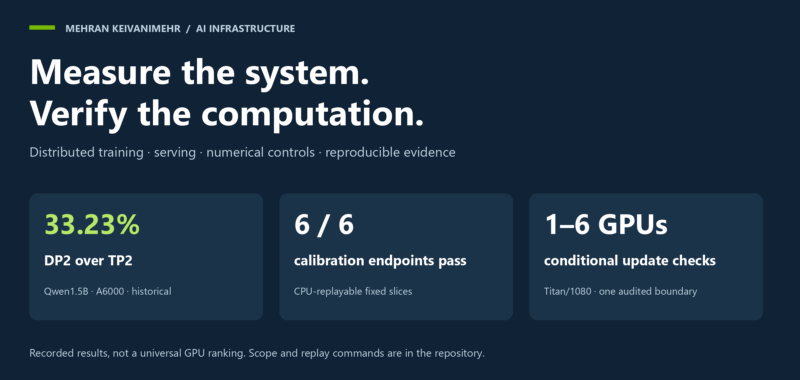
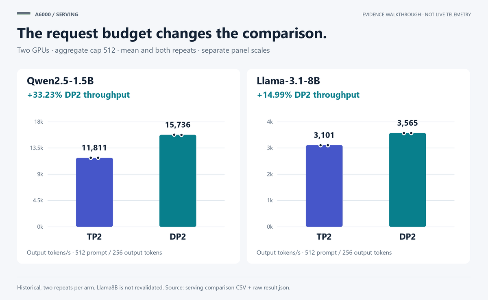

# Multi-GPU Systems Lab

**Mehran Keivanimehr** · Distributed training, LLM serving and numerical verification



I built this study around a practical question: when a multi-GPU benchmark looks good, what evidence makes it trustworthy? The repository connects the benchmark harness, the numerical controls and the result itself. You can inspect the recipes, trace a plotted value to its run, and replay the retained comparisons without a GPU. [Project implementation (2026/10), [engineering notes](docs/ENGINEERING.md), [replay guide](docs/REPRODUCING.md)]

## Three results worth opening

| Question | Recorded result | What it means here |
|---|---|---|
| Does data parallel serving beat tensor parallel serving at the same request budget? | A6000 DP2: **+33.23%** for Qwen1.5B; **+14.99%** for Llama8B | Equal total concurrency cap 512, two repeats per arm. Historical throughput—not output correctness or a universal deployment rule. |
| Can the one-versus-two-GPU FP32 control be replayed? | **6/6 fixed-slice endpoints pass** | Five updates over the same 20 global inputs. The 12.6 MB calibration arrays are included. |
| Do sharded optimizer updates agree with the consumed gradient? | **16 training contexts**, 1/2/4/6 GPUs on Titan/1080 | One audited boundary per context; conditional update agreement, not independently recomputed gradients or convergence. |

[Evidence (2026/10), [derived values and run IDs](results/showcase.json), [A6000 ledger](results/a6000_validation/evidence/70_final_review/CLAIM_LEDGER_v2.csv), [Titan ledger](results/diagnostics/context_ledger.json)].



The animation walks through four static evidence views. It is not live telemetry or a simulated benchmark. [Figure sources (2026/10), [gallery and captions](assets/README.md)].

## Read the results

- [Results and engineering interpretation](reports/REPORT.md): the main figures, tables and consequences.
- [A6000 study](docs/A6000.md): serving layout comparisons, precision contrasts and replayable calibration.
- [Titan/1080 study](docs/TITAN.md): historical scaling, conditional update checks and the retained inference reference.
- [Engineering decisions](docs/ENGINEERING.md): controls, rank accounting, ownership and reproducible publication.
- [Scientific scope](docs/SCIENTIFIC_STATUS.md): supported, qualified, historical and excluded claims.

## Retained inference checks

The cross-family TinyLlama logit comparison is **PASS**: maximum absolute difference **2.765656e-05** against the frozen **1.226736e-04** tolerance. The complete arrays are included. The separate streaming session records **100 of 100** successful responses, but not valid per-request latency. [Titan inference evidence (2026/10), [reference and streaming interpretation](docs/TITAN.md), [context ledger](results/diagnostics/context_ledger.json)].

## Verify in a few minutes

The commands below read shipped data and run CPU-only checks; they do not launch a model or contact a cluster. [Verification contract (2026/10), [TESTING.md](TESTING.md), [profile implementation](tools/release_checks.py)].

```sh
python -I -S tools/verify_a6000.py
python -I -S tools/recompute_reference_verdict.py --a results/diagnostics/closing/reference/TITAN_RTX_1 --b results/diagnostics/closing/reference/GTX_1080Ti_1
python -B tools/release_checks.py --profile portable
```

See [reproduction](docs/REPRODUCING.md) for figures, optional numerical tests and the distinction between analysis replay and new GPU experiments. GitHub Actions is configured; no remote CI run is claimed by this local release.

## Systems covered

| Study | Hardware and workload | Evidence status |
|---|---|---|
| A6000 | RTX A6000; DDP/FSDP2/ZeRO; Qwen, ResNet and serving TP/DP | Qualified closeout; fresh controls at 1–2 GPUs, historical performance retained separately |
| Titan/1080 | TITAN RTX / GTX 1080 Ti; GPT-2, reference inference and streaming | 19 diagnostic contexts: 17 supported, 2 qualified; historical performance is a separate cohort |
| A100 | A100-SXM4-40GB; training and inference records | Historical reference only; no matched cross-platform ranking |

[Study records (2026/10), [A6000](docs/A6000.md), [Titan/1080](docs/TITAN.md), [A100](studies/a100/CURRENT_REPORT.md), [protocol comparison](docs/METHODOLOGY.md)].

## Repository map

```text
studies/                  benchmark sources, configs and historical measurements
results/a6000_validation/ retained A6000 closeout evidence and calibration slices
results/diagnostics/      Titan numerical/reference/streaming evidence
tools/                    CPU verifiers, report builders and figure source
tests/                    explicit portable, numerical and lifecycle test suites
assets/                   SVG/PNG figures and the evidence walkthrough
docs/                     engineering, protocols, references and scope
provenance/               public evidence checksums and input-archive identity
```

## Technical foundations

The design draws on NVIDIA's floating-point and NCCL measurement definitions and the DDP, FSDP, ZeRO, mixed-precision, AdamW and PagedAttention papers. They explain the mechanisms; the measurements in this repository support the project-specific conclusions. [Primary sources (accessed 2026/10), [reading guide](docs/REFERENCES.md)].

## Citation and rights

Author: **Mehran Keivanimehr**. Cite [CITATION.cff](CITATION.cff). The project currently reserves all rights; public hosting is not a grant of an open-source license. Dependencies and model artifacts retain their own terms. See [LICENSE](LICENSE) and [licensing notes](docs/LICENSING.md).

## Limitations

The study uses synthetic inputs and short numerical controls, not convergence or training-quality evaluations. There is no matched all-platform speed ranking. ResNet agreement, A6000 inference output/reference agreement and complete all-framework two-GPU validation remain unestablished; four-GPU/8B training and ZeRO-3 validation remain deferred. Titan training checks are conditional on the observed gradient; full boundary tensors were not retained. Streaming is one qualified session and does not establish request latency. Full details and data-availability boundaries are in [LIMITATIONS.md](docs/LIMITATIONS.md). These qualifications also stay beside the results they affect.
