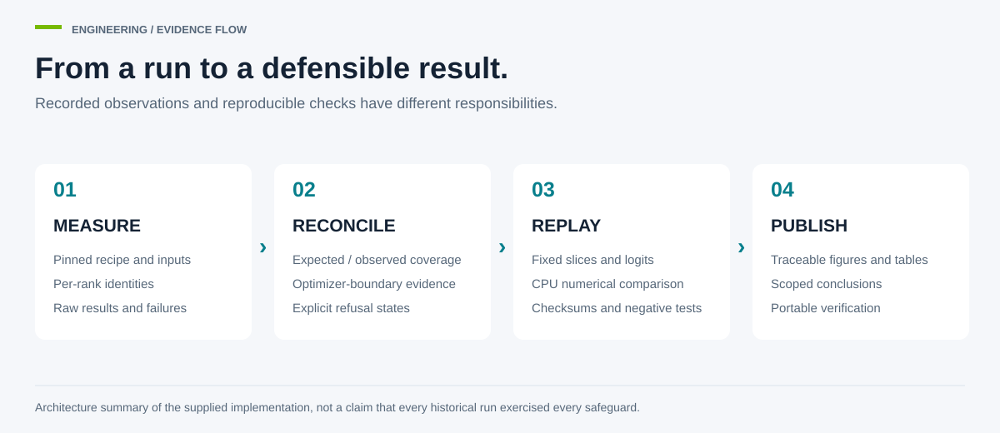

# Engineering decisions

Mehran Keivanimehr · October 2026

The useful part of a benchmark is not just its fastest row. I wanted the repository to answer how a number was produced, what was checked, and what a failure would look like. The implementation separates collection, reconciliation, replay and publication. [Project source (2026/10), [study sources](../studies/), [verification tools](../tools/)].

## What is implemented

| Responsibility | Implementation | Evidence boundary |
|---|---|---|
| Matched inputs and canonical state | [A6000 control C](../studies/a6000/src/mgbench/control_c.py) | Shared global sample identities and post-wrap state checks; a seed alone is not the proof |
| Expected/observed gradient accounting | [Boundary ledger](../studies/a6000/src/mgbench/train/boundary_ledger.py) | Distinguishes complete, partial, empty, repeated, non-finite and unobserved coverage |
| Sampled parameter/state checks | [AdamW evidence](../studies/a6000/src/mgbench/train/update_evidence.py) | Samples are reported as samples, not whole-model update verification |
| Observation at the optimizer boundary | [Titan engine probe](../studies/titan-1080/zerodiag/engine_probe.py) | Captures the gradient consumed by the base optimizer after unscale/clip |
| Chunk-bounded numerical oracle | [Update oracle](../studies/titan-1080/zerodiag/update_oracle.py) | Bounds temporary workspaces; complete snapshots still have a memory cost |
| Owned-process cleanup | [A6000 scopes](../studies/a6000/src/mgbench/scopes.py), [Titan ownership](../studies/titan-1080/zerodiag/ownership.py) | Refuses uncertain ownership/cleanup rather than signalling unrelated processes |
| Reproducible analysis | [A6000 verifier](../tools/verify_a6000.py), [figure builder](../tools/render_figures.py) | Reads retained observations; does not invent missing measurements |

[Implementation inventory (2026/10), source links in the table; [claim/evidence distinctions](../results/a6000_validation/evidence/70_final_review/CLAIM_EVIDENCE_TABLE.csv)].

## Decisions that changed the analysis

**Serving comparisons need the same budget.** The original TP2 cohort allowed 256 concurrent requests while DP2 allowed 512 in total. The published comparison uses the TP2 cap-512 audit instead. Both raw cohorts remain identified. [A6000 audit (2026/10), [comparison rows](../studies/a6000/results/rerun/vllm_tp_concurrency_comparison.csv)].

**A call counter is not an update proof.** The diagnostic distinguishes attempted logical boundaries, base optimizer calls, observed gradients, coverage and parameter/state evidence. Later tests do not validate historical runs that lacked those observations. [Accounting (2026/10), [current evidence table](../results/a6000_validation/evidence/70_final_review/CLAIM_EVIDENCE_TABLE.csv)].

**Precision is part of the recipe.** FP32 parameters under autocast, BF16 model parameters and FP32 master optimizer state are not interchangeable configurations. In the matched first-boundary test, the native BF16 and DeepSpeed BF16 gradients match each other while both differ from FP32. [Project contrast (2026/10), [results](A6000.md)]; [NVIDIA mixed precision (accessed 2026/10), [training procedure](https://docs.nvidia.com/deeplearning/performance/mixed-precision-training/index.html)].

**Failure states should survive publication.** Refusals, unavailable checks and original qualifications remain distinct from numerical failures. The current ledgers preserve what changed without claiming a corrected checker ran before it existed. [Evidence (2026/10), [Titan ledger](../results/diagnostics/context_ledger.json), [A6000 ledger](../results/a6000_validation/evidence/70_final_review/CLAIM_LEDGER_v2.csv)].

## Reproduction instead of screenshots

The figures are built from [showcase.json](../results/showcase.json), which is derived from run records and losslessly retained calibration slices. SVG sources, PNG exports, captions and rendering code are included. The GIF is a walkthrough of those static views, not a replay of cluster telemetry. [Publication pipeline (2026/10), [builder](../tools/build_showcase.py), [renderer](../tools/render_figures.py), [captions](../assets/README.md)].

## Limitations

Runtime safeguards do not establish that the host outage was diagnosed or that a node cannot fail. Publication metadata edits change source bytes: historical authorization/source receipts do not authorize this derived tree. New GPU execution requires a fresh facility-approved allocation and source-bound plan. The complete scientific boundary is in [LIMITATIONS.md](LIMITATIONS.md).
