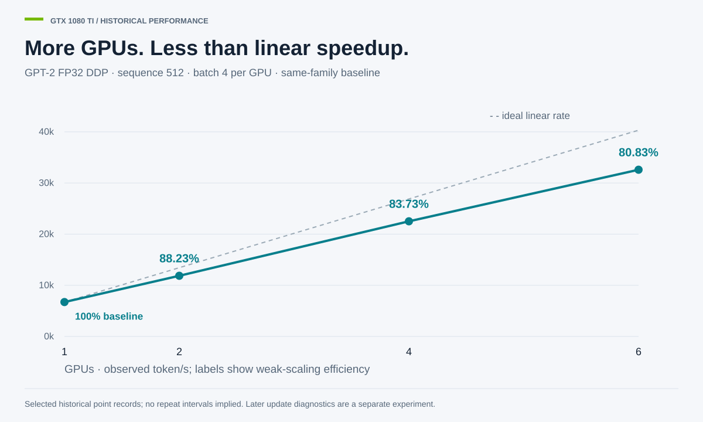

# Titan / GTX 1080 Ti study

Mehran Keivanimehr · qualified closeout, October 2026

The historical performance campaign and later numerical validation answer different questions. They are linked by hardware and recipes, not treated as one experiment. [Titan records (2026/10), [historical tables](../studies/titan-1080/results/), [diagnostic ledger](../results/diagnostics/context_ledger.json)].

## Historical weak scaling



For GTX 1080 Ti FP32 GPT-2 DDP at sequence 512 and batch four per GPU, the selected historical rows record 88.23%, 83.73% and 80.83% efficiency at two, four and six GPUs against the family-matched baseline. Global batch increases with GPU count; this is weak scaling, not a fixed-total-batch strong-scaling test. [Scaling records (2026/10), [table](../studies/titan-1080/results/scaling_efficiency.csv)].

## What the numerical checks establish

Sixteen training contexts cover ZeRO stage/precision/world-size combinations across GTX 1080 Ti and TITAN RTX. Their one-boundary checks support agreement with an AdamW oracle conditional on the observed consumed gradient. Rank/partition inventories reconcile; later checks establish the required working/master relationship. The complete context census is 17 supported and two qualified over 19 contexts. [Diagnostic evidence (2026/10), [numerical results](../results/diagnostics/numerical_results.md), [context ledger](../results/diagnostics/context_ledger.json)].

The optimizer reference distinguishes decoupled weight decay from a coupled penalty, consistent with the AdamW formulation. The installed optimizer's resolved options and observed state define the comparison, not the optimizer's class name alone. [AdamW (2019/01), [paper](https://arxiv.org/abs/1711.05101)]; [Project oracle (2026/10), [implementation](../studies/titan-1080/zerodiag/update_oracle.py)].

## Retained inference arrays

The TITAN RTX and GTX 1080 Ti reference runs use matched realized inputs and initial state. Final logits have maximum difference 2.765656e-05 against the frozen 1.226736e-04 tolerance, with zero failures among 256,000 elements. Greedy IDs match separately. Complete arrays are retained, so the comparison can be replayed. [Reference evidence (2026/10), [arrays](../results/diagnostics/closing/reference/), [verifier](../tools/recompute_reference_verdict.py)].

```sh
python -I -S tools/recompute_reference_verdict.py --a results/diagnostics/closing/reference/TITAN_RTX_1 --b results/diagnostics/closing/reference/GTX_1080Ti_1
```

## Streaming observations

One session records 100 successful responses under the frozen completion rule. Event arrival offsets are session-relative, not request latency; no request starts were retained. The original listener and aggregate server/client memory conditions retain their qualifications. [Streaming evidence (2026/10), [current corrections](LOCAL_RELEASE_CORRECTIONS.md), [recomputed observations](../results/diagnostics/streaming_session/recomputed_offline.json)].

## Limitations

The gradient is observed, not independently recomputed. One boundary does not establish convergence, training quality or AMP skip behavior over extended training. Full training-boundary tensors were not retained; Gate-0's original criterion qualification remains. Later diagnostics do not validate historical performance retroactively. See [LIMITATIONS.md](LIMITATIONS.md).
