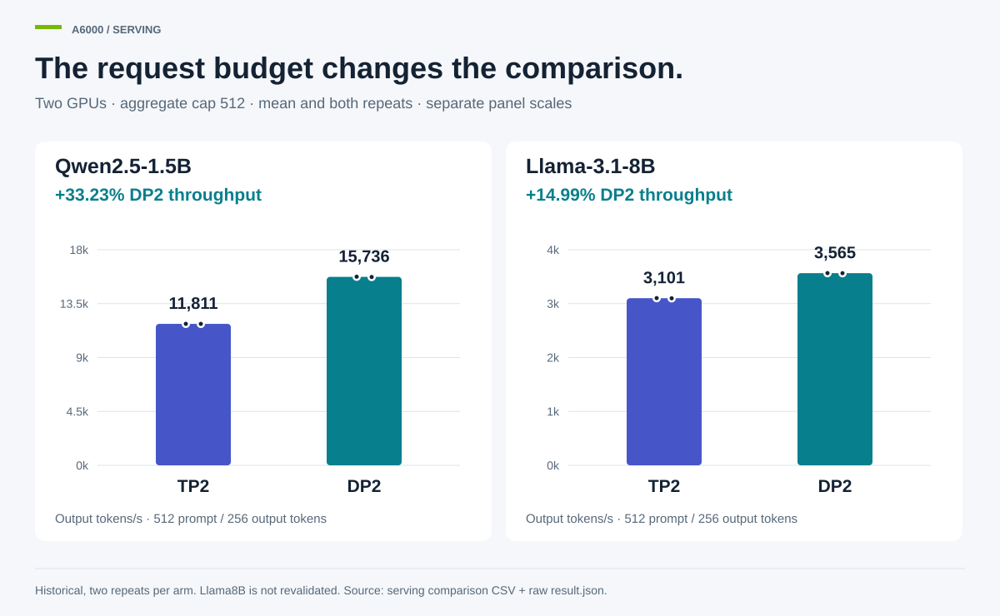
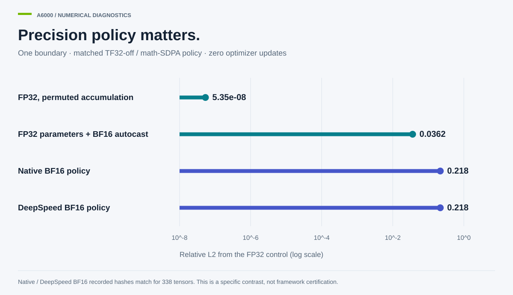
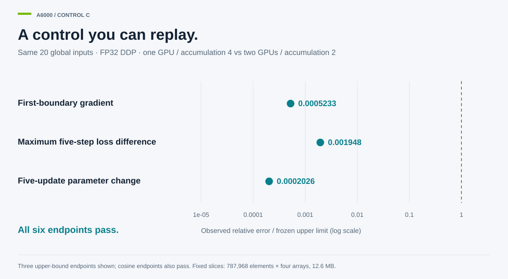

# Results and engineering interpretation

Mehran Keivanimehr · October 2026

This study keeps historical performance measurements separate from later numerical diagnostics. Each result below identifies its cohort and what was actually checked. No cross-platform speed ranking is calculated. [Project protocols (2026/10), [comparison matrix](../docs/METHODOLOGY.md)]

## Serving: the concurrency cap changes the comparison

| Model | TP2 mean output tok/s | DP2 mean output tok/s | DP2 difference | Evidence |
|---|---:|---:|---:|---|
| qwen2.5-1.5b | 11,810.9 | 15,736.2 | +33.23% | two repeats/arm; aggregate cap 512 |
| llama3.1-8b | 3,100.7 | 3,565.4 | +14.99% | two repeats/arm; aggregate cap 512 |

Both layouts use two GPUs and a total concurrency cap of 512. TP2 is taken from the matched-cap audit, not the original cap-256 rows. Llama8B is a historical observation, not newly validated 8B training or inference correctness. [A6000 records (2026/10), [comparison CSV](../studies/a6000/results/rerun/vllm_tp_concurrency_comparison.csv), [derived rows and run IDs](../results/showcase.json)]

**Engineering consequence:** compare complete serving layouts under the same request budget before choosing a deployment configuration. These data favor DP2 for these models and request settings; they do not establish a universal DP-versus-TP rule. [A6000 records (2026/10), [scope and claim ledger](../results/a6000_validation/evidence/70_final_review/CLAIM_LEDGER_v2.csv)]

## Precision: matching the policy changes the diagnosis

The matched-policy investigation extracts one accumulation-boundary gradient, without executing an optimizer update. Native BF16 and DeepSpeed BF16 have identical recorded hashes over 338 tensors; each differs from the FP32 control by about 0.2175 in relative L2. FP32 parameters with BF16 autocast differ by about 0.0362. [A6000 first-boundary evidence (2026/10), [per-tensor results](../results/a6000_validation/evidence/48_c20_fb_summary/out/fb_summary.json)]

**Engineering consequence:** a framework label is not a precision contract. The observed deviation can be reproduced under the native BF16 policy without DeepSpeed in this particular case. Weight, accumulation and residual precision inside that policy were not isolated as separate causes. NVIDIA describes precision-dependent rounding behavior; it does not certify the project's numerical thresholds. [NVIDIA floating point (accessed 2026/10), [§2.2](https://docs.nvidia.com/cuda/floating-point/index.html#operations-and-accuracy)]; [Project contrast (2026/10), [protocol](../docs/A6000.md)].

## Calibration: replay the comparison, not just its verdict

| Fixed-slice endpoint | Recomputed value | Frozen limit |
|---|---:|---:|
| G1_rel_l2 | 5.23273277e-08 | ≤ 0.0001 |
| G1_cosine | 1 | ≥ 0.99999 |
| U_rel_l2 | 1.01312111e-05 | ≤ 0.05 |
| U_cosine | 1 | ≥ 0.999 |
| L_k0_rel | 0 | ≤ 1e-06 |
| L_max_k0_4_rel | 1.94834174e-08 | ≤ 1e-05 |

The one-GPU FP32 DDP control uses accumulation 4; the two-GPU control uses accumulation 2. Both run five updates over the same 20 global inputs. The four shipped arrays contain the preregistered fixed slices (12,607,488 bytes), not full-model gradients. [Control C (2026/10), [retained data](../results/a6000_validation/evidence/70_final_review/calibration_slices/), [CPU verifier](../tools/verify_a6000.py)]

## Distributed execution: coverage before a success label

The historical GTX 1080 Ti FP32 DDP arm uses GPT-2, sequence 512 and batch 4 per GPU. Recorded efficiency is 88.23%, 83.73% and 80.83% at two, four and six GPUs against the same-family one-GPU baseline. This is weak scaling: the global batch increases with world size. No uncertainty interval is invented for these selected historical point records. [Titan scaling (2026/10), [source table](../studies/titan-1080/results/scaling_efficiency.csv)]

Later Titan/1080 diagnostics cover 16 one-boundary training contexts and reconcile rank/partition coverage. They support conditional optimizer-update agreement, not independent gradient correctness or retroactive certification of the historical throughput. The 19-context census is 17 supported and 2 qualified, with Gate-0 and streaming retaining their qualifications. [Titan diagnostics (2026/10), [context ledger](../results/diagnostics/context_ledger.json)]

## What the infrastructure contributes

- A frozen input/control design and full-state identity checks rather than seed-only equivalence. [Implementation (2026/10), [A6000 control](../studies/a6000/src/mgbench/control_c.py)]
- Base-optimizer boundary observations, expected/observed inventories and chunked oracle checks. [Implementation (2026/10), [Titan diagnostic](../studies/titan-1080/zerodiag/engine_probe.py), [oracle](../studies/titan-1080/zerodiag/update_oracle.py)]
- Ownership-scoped process cleanup and explicit authorization/resource admission contracts. Source and regression tests are provided; modified publication bytes are not authorized for unattended GPU execution. [Implementation (2026/10), [A6000 scopes](../studies/a6000/src/mgbench/scopes.py), [Titan ownership](../studies/titan-1080/zerodiag/ownership.py)]
- CPU-only replay, data manifests and tests that preserve the difference between a failure, a refusal and a missing observation. [Verification (2026/10), [test profiles](../TESTING.md), [provenance](../provenance/README.md)]

## Historical A100 reference

A100 observations remain available as a separate reference campaign. Its model lengths, optimizers and precision paths differ; it is not pooled into A6000 or Titan validation. [A100 records (2026/10), [current interpretation](../studies/a100/CURRENT_REPORT.md), [data](../studies/a100/all_results.csv)]

## References

See the [primary-source reading guide](../docs/REFERENCES.md) for NVIDIA documentation and the DDP, FSDP, ZeRO, mixed-precision, AdamW and PagedAttention papers. These references explain mechanisms; the project measurements supply the empirical results.

## Limitations

Synthetic inputs and short diagnostics do not establish convergence or model quality. Historical performance and diagnostic cohorts are distinct. Full tensor replay is available for the exported control slices and Titan inference arrays, not every full-model comparison. ResNet agreement, A6000 output/reference agreement and complete all-framework two-GPU validation remain unestablished; four-GPU/8B training and ZeRO-3 work remain deferred. Energy and latency headlines and causal bottleneck claims are not promoted. See [the complete scope statement](../docs/LIMITATIONS.md).
