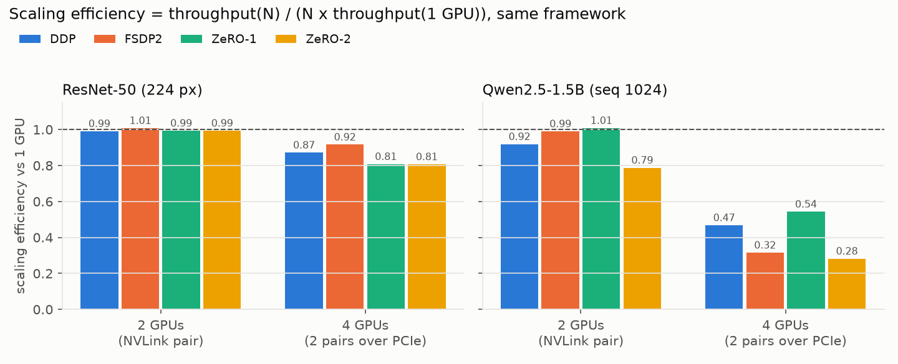

# multigpu-bench: multi-GPU training and inference benchmarks on RTX A6000

A modular, reproducible benchmark suite that measures **throughput, GPU utilization, peak memory and scaling
efficiency** for

| | |
|---|---|
| **Training** | PyTorch **DDP**, PyTorch **FSDP2** (`fully_shard`), **DeepSpeed ZeRO-1/2/3** |
| **Inference** | **vLLM** offline throughput, tensor parallel vs. data parallel |
| **Models** | **Llama-3.1-8B** (Meta), **Qwen2.5-1.5B / 0.5B** (Alibaba), **ResNet-50** (torchvision) |
| **Hardware** | 1, 2 and 4 NVIDIA RTX A6000 48 GB on a shared 8-GPU server (GPUs 4-7) |

Stage 1 covers a single node. The full measured results are in **[reports/REPORT.md](reports/REPORT.md)**.

**Scientific correction:** use [CURRENT_REPORT.md](CURRENT_REPORT.md) as the current interpretation. The earlier report and figures are historical; scientific-v2 GPU validation is pending. [Remediation (2026/10), [status register](../../docs/SCIENTIFIC_STATUS.md)]

## Results at a glance (measured 2026-10-13, medians of 3 training / 2 inference repeats)

**Training** uses weak scaling (fixed per-GPU batch), bf16, AdamW. Efficiency is `T(N) / (N x T(1))` for the same
framework. The earlier claim that every repeat agrees within 1% is withdrawn: sample CV and full-range statistics are distinct. [Repeat evidence (2026/10), [corrected statistics](../../results/corrections/a6000_repeats.csv)]

| Workload | Framework | 1 GPU | 2 GPUs (NVLink) | 4 GPUs (2 pairs, PCIe) | Efficiency 2 / 4 GPUs | Peak mem/GPU at 4 GPUs |
|---|---|---:|---:|---:|---:|---:|
| ResNet-50 (img/s) | DDP | 1,058 | 2,096 | 3,688 | 99% / 87% | 6.8 GiB |
| ResNet-50 (img/s) | FSDP2 | 1,051 | 2,118 | 3,851 | 101% / 92% | 6.5 GiB |
| ResNet-50 (img/s) | ZeRO-1 | 981 | 1,948 | 3,169 | 99% / 81% | 14.0 GiB |
| ResNet-50 (img/s) | ZeRO-2 | 982 | 1,950 | 3,167 | 99% / 81% | 14.0 GiB |
| Qwen2.5-1.5B (tok/s) | DDP | 3,992 | 7,335 | 7,472 | 92% / 47% | 38.2 GiB |
| Qwen2.5-1.5B (tok/s) | FSDP2 | 3,553 | 7,034 | 4,479 | 99% / 32% | 18.2 GiB |
| Qwen2.5-1.5B (tok/s) | ZeRO-1 | 4,071 | 8,209 | 8,845 | 101% / 54% | 23.3 GiB |
| Qwen2.5-1.5B (tok/s) | ZeRO-2 | 3,542 | 5,579 | 3,998 | 79% / 28% | 21.9 GiB |
| Llama-3.1-8B (tok/s) | FSDP2 | estimated skip | estimated skip | 994 | - | 43.3 GiB |
| Llama-3.1-8B (tok/s) | ZeRO-3 | estimated skip | estimated skip | 973 | - | 43.6 GiB |

*Llama-3.1-8B note:* ZeRO-3 shows ~2 allocator retries per step with default DeepSpeed buffers; FSDP2 shows none.
An audit re-run with more memory headroom reproduced both numbers within 1-2 %
([results/rerun/RERUN_ANALYSIS.md](results/rerun/RERUN_ANALYSIS.md)).

**Inference (vLLM)** uses strong scaling: the same 1024 requests (512 prompt + 256 generated tokens) on every
layout, with concurrency matched to the GPU count (256 concurrent requests per GPU: one engine at 256 for TP1 and
each DP engine, 512 for TP2, 1024 for TP4). The percentage in brackets is scaling efficiency against one GPU.

| vLLM output tok/s | TP1 (1 GPU) | TP2 | DP2 | TP4 | DP4 |
|---|---:|---:|---:|---:|---:|
| Qwen2.5-1.5B-Instruct | 7,819 | 11,811 (76%) | 15,736 (101%) | 4,993 (16%) | 31,596 (101%) |
| Llama-3.1-8B-Instruct | 1,771 | 3,101 (88%) | 3,565 (101%) | 1,830 (26%) | 7,175 (101%) |

TP2 and TP4 are the matched-concurrency audit re-run results; TP1 and DP are from the main run. TP4 uses
`NCCL_P2P_LEVEL=NVL` on 4 GPUs, because direct PCIe peer-to-peer between the two NVLink pairs hangs on this node
(see finding 6). **Data parallel beats tensor parallel even at matched concurrency (1.15–1.33× on NVLink, 3.9–6.3×
across PCIe).**



### Scoped observations

The recorded training and matched-cap inference rates remain historical observations. Their precision recipes, initialization controls, small repeat counts and telemetry limitations prevent a universal framework or hardware ranking. The full corrected interpretation and source records are in [CURRENT_REPORT.md](CURRENT_REPORT.md). [Scientific interpretation (2026/10), current report]

- Interconnect bandwidth and reduction-precision ablations are measured controls, but do not uniquely identify the complete runtime bottleneck.
- DP outperformed TP under the specified models, concurrency caps and engine defaults; approximately linear point estimates are not proof of perfect scaling.
- Large-model estimated skips were not executed OOM tests. Successful four-GPU full-sharding runs do not prove that every other possible recipe cannot fit.
- P2P failures and transport workarounds apply to this host. The underlying host-setting cause remains unverified.
- Historical inference mean power/utilization includes non-generation time. New code corrects the selection window, but target-host validation is pending.

[Observation scope (2026/10), [current report](CURRENT_REPORT.md), [audit registry](../../audit/findings.csv)]

## Project layout

```
configs/
  cluster.yaml              safety limits: GPU allowlist, GPU sets per count, memory cap, idle gate, timeouts
  models.yaml               model registry (architecture configs, pinned HF revisions)
  models/<name>/config.json vendored architecture configs (training runs never touch the network)
  frameworks/               ddp.yaml, fsdp.yaml, ds_zero{1,2,3}.json, vllm.yaml
  experiments/              train_scaling.yaml, vllm_scaling.yaml (results); smoke*, probe_*, nccl*, vllm_tp4_diag
                            (checks, batch-size selection, interconnect diagnosis); llama8b_memory_rerun.yaml,
                            vllm_tp_concurrency_rerun.yaml (audit re-runs)
src/mgbench/
  config.py                 YAML loading, experiment -> ordered run specs, GPU allowlist validation
  safety.py                 memory feasibility estimate, idle gate, cleanup of a run's own processes
  gpu_monitor.py            NVML sampler (utilization, memory, power, temperature, clocks)
  metrics.py                step statistics, model FLOPs / MFU, scaling efficiency, bus bandwidth
  models.py / data.py       random-init models (incl. meta-device init for FSDP), synthetic batches
  results.py                JSON writer, environment capture (versions, driver, topology)
  train/                    training benchmark (python -m mgbench.train), one setup per framework
  infer/vllm_bench.py       vLLM benchmark (TP within one engine, DP across engines behind a barrier)
  comm/                     NCCL all-reduce bandwidth sweep
scripts/
  run_matrix.py             the only launcher: runs an experiment file safely, one run at a time
  run_all.sh                the full Stage-1 sequence (smoke -> vLLM smoke -> NCCL -> training 1/2/4 GPUs -> vLLM -> report)
  aggregate.py              results/raw -> results/*.csv
  make_report.py            results/*.csv -> reports/REPORT.md + reports/figures/*.png
  compare_reruns.py         audit re-runs vs. original results -> results/rerun/*.csv, tables.md
  cleanup.sh                removes caches/temp files (keeps results and the venv)
tests/                      CPU-only unit tests (allowlist, estimator, FLOPs/param counts, metric math)
results/raw/<experiment>/<run_id>/
  spec.json, command.txt, run.log, result.json, status.json, nvidia_smi_{before,after}.txt
results/rerun/              RERUN_ANALYSIS.md + comparison tables for the audit re-runs
```

## Setup

```bash
cd multigpu-bench
uv venv .venv --python 3.12
uv pip install --python .venv/bin/python -r requirements.txt
DS_BUILD_OPS=0 uv pip install --python .venv/bin/python --no-build-isolation-package deepspeed deepspeed==0.19.7
uv pip install --python .venv/bin/python -e . --no-deps
.venv/bin/python -m pytest -q          # CPU-only checks, no GPU used
```

`requirements.lock.txt` pins every package version used for the published results. DeepSpeed is installed
without compiled ops (no `nvcc` on the host) and uses PyTorch's AdamW, so nothing is JIT-compiled.

Model weights are only needed for vLLM. Training builds the architecture from `configs/models/*/config.json`
with random weights. These runs characterize that synthetic training recipe, not pretrained-model quality or guaranteed identical timing for other parameter values.

```bash
.venv/bin/python -c "from huggingface_hub import snapshot_download as d; \
  d('unsloth/Llama-3.1-8B-Instruct', revision='4699cc75b550f9c6f3173fb80f4703b62d946aa5', allow_patterns=['*.json','*.safetensors']); \
  d('Qwen/Qwen2.5-1.5B-Instruct', revision='989aa7980e4cf806f80c7fef2b1adb7bc71aa306')"
```

`unsloth/Llama-3.1-8B-Instruct` is an ungated re-upload of `meta-llama/Llama-3.1-8B-Instruct` with an
identical config. The Meta repo is gated, and this account has no access to it. The Llama 3.1 Community
License applies.

## How to run on the A6000 node

Every GPU job goes through `scripts/run_matrix.py`. Do not call `torchrun` directly on a shared node.

```bash
# See what would run, with no GPU use: feasibility decisions included
.venv/bin/python scripts/run_matrix.py configs/experiments/train_scaling.yaml --dry-run

# Smoke test: every framework, 1 GPU then 2 GPUs, a few steps each
.venv/bin/python scripts/run_matrix.py configs/experiments/smoke.yaml

# Single-GPU baselines only
.venv/bin/python scripts/run_matrix.py configs/experiments/train_scaling.yaml --gpus 1

# One model / framework subset
.venv/bin/python scripts/run_matrix.py configs/experiments/train_scaling.yaml --models qwen2.5-1.5b --frameworks ddp,fsdp

# Interconnect bandwidth, vLLM inference
.venv/bin/python scripts/run_matrix.py configs/experiments/nccl.yaml
.venv/bin/python scripts/run_matrix.py configs/experiments/vllm_scaling.yaml

# Everything, in the safe order, then tables + plots
bash scripts/run_all.sh

# Tables and figures from whatever has finished
.venv/bin/python scripts/aggregate.py && .venv/bin/python scripts/make_report.py

# Stop cleanly before the next run starts
touch .cache/STOP
```

Runs are **resumable**. A configuration with `status.json` = `ok` is skipped on the next invocation, so you
can rerun after an interruption; use `--force` to redo it. To add a model, add an entry to
`configs/models.yaml` with its `config.json`. To add a configuration, add it to an experiment YAML.

## Safety design (shared server)

| Risk | Guard |
|---|---|
| Touching other people's GPUs | `allowed_gpus: [4,5,6,7]` in `configs/cluster.yaml`. Every run's GPU list is validated against it, and the unit tests check that every experiment file stays inside it. Each run gets an explicit `CUDA_VISIBLE_DEVICES` with `CUDA_DEVICE_ORDER=PCI_BUS_ID`, so CUDA numbering equals `nvidia-smi` numbering. |
| Sharing a GPU with someone else's job | **Idle gate** before every run. The run's GPUs and the previous run's GPUs must show no processes from any user, at most 100 MiB used (NVML v2, the same reading as `nvidia-smi`), 0 % utilization, under 60 W, at most 50 °C, and at least 150 GiB free host RAM, for three polls in a row. The runner waits up to 30 min and otherwise **aborts** without launching anything. |
| Out of memory on the node | A memory estimator skips configurations whose model states alone exceed 44 GiB per GPU (recorded as `skipped_infeasible`). Every rank also sets `torch.cuda.set_per_process_memory_fraction(0.92)`, and vLLM is capped at `gpu_memory_utilization=0.85`. |
| Runaway or hung jobs | Fixed step counts. A hard per-run timeout (20 min) sends SIGTERM to the run's own process group, then SIGKILL. NCCL has a 5-min collective timeout. 3 consecutive failures abort the matrix. |
| Orphaned processes | Every process a run spawns carries `MGBENCH_RUN_ID`. After the run, only processes with that marker and our UID are cleaned up. Nothing else is ever signalled. |
| Host CPU / RAM pressure | Runs are pinned to NUMA node 1 (the socket GPUs 4-7 attach to) with `numactl`, and `OMP_NUM_THREADS=8` per rank. Data is synthetic and generated once on the GPU. |
| Disk | No checkpoints are written. Compiler and vLLM caches go to `.cache/`, which `scripts/cleanup.sh` removes. Results are a few MB. |
| Two launchers at once | A file lock (`.cache/runner.lock`) allows only one `run_matrix.py`. |

A `nvidia-smi` snapshot is saved before and after every run (`results/raw/.../nvidia_smi_{before,after}.txt`).

## Methodology

- **Training (weak scaling):** fixed per-GPU micro-batch, bf16 compute, AdamW (lr 1e-4), synthetic seeded
  data held on the GPU. Each run does warmup steps, then N timed steps. Throughput is
  `global_batch x steps / wall time`. Step time is the slowest rank per step. Scaling efficiency is
  `T(N) / (N x T(1))` for the same framework. Configurations are repeated (3x) with repeats interleaved, and
  medians are reported.
- **Precision recipes:** each framework uses its standard bf16 recipe. DDP: fp32 weights + `torch.autocast`.
  FSDP2: fp32 sharded weights with `MixedPrecisionPolicy(bf16, reduce fp32)`. DeepSpeed: `bf16` mode (bf16
  weights, fp32 master copy in the ZeRO optimizer). Gradient communication is fp32 everywhere
  (`communication_data_type: fp32` for DeepSpeed). This does not establish identical total communication volume or identical numerical behavior across frameworks. [Recipe source (2026/10), [frameworks](src/mgbench/train/frameworks.py)]
- **MFU:** model FLOPs (6N + 12·L·d·T per token for LMs, counted FLOPs for ResNet-50) over the A6000's
  154.8 TFLOPS dense BF16 peak. Activation-checkpoint recompute is not counted.
- **Memory:** peak reserved by the PyTorch caching allocator (max over ranks), plus the NVML device peak.
- **GPU utilization:** NVML `utilization.gpu`, sampled at 5 Hz during the timed window. It is the share of
  time a kernel was running, not SM occupancy.
- **vLLM (strong scaling):** a fixed workload of 1024 requests with 512 random prompt tokens and exactly 256
  output tokens (greedy, `ignore_eos`), on real pretrained weights. TP splits one engine across GPUs. DP
  runs independent engines, released together by a barrier, with throughput over the common window.
  Concurrency is matched per GPU: `max_num_seqs` is 256 per GPU (256 per DP engine, 512 for TP2, 1024 for TP4;
  `configs/experiments/vllm_tp_concurrency_rerun.yaml`).
- **Batch sizes (chosen by `probe_1gpu` / `probe_4gpu`, kept in `configs/experiments/`):** ResNet-50 128
  images/GPU. Qwen2.5-1.5B: 1 sequence of 1024 tokens x 4 accumulation steps per GPU (DDP with autocast OOMs at
  micro-batch 2 because the residual stream stays fp32). Llama-3.1-8B: 2 x 1024 tokens with activation
  checkpointing.
- **Limits:** synthetic data means the input pipeline isn't measured. Results are for this node's topology:
  GPUs 4-5 and 6-7 are NVLink pairs, and 4/5 to 6/7 is PCIe. 8-GPU runs were not part of Stage 1 by
  decision, since GPUs 0-3 are used by others.
