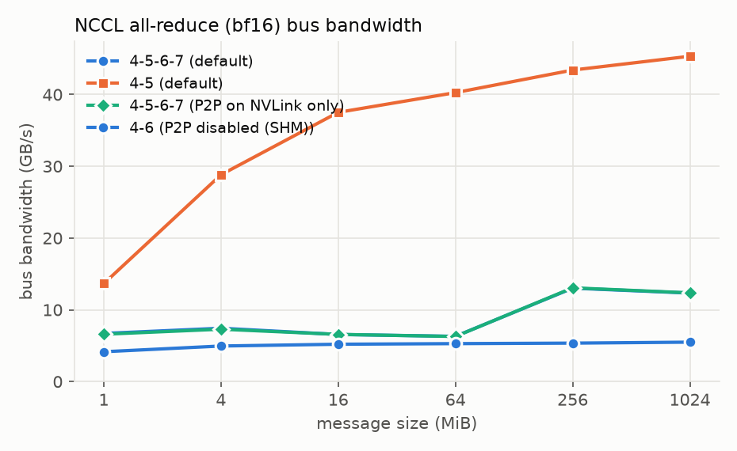
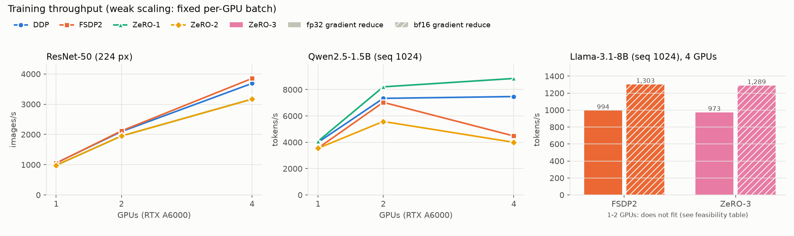
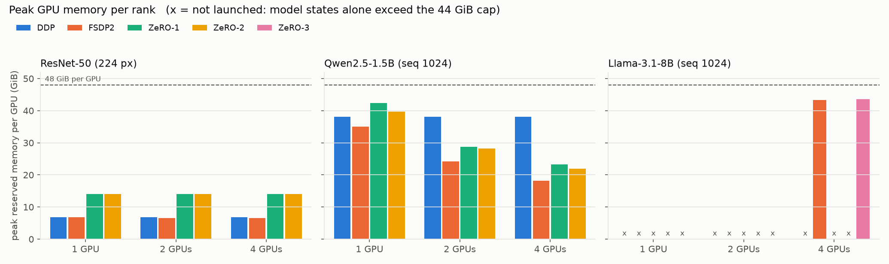
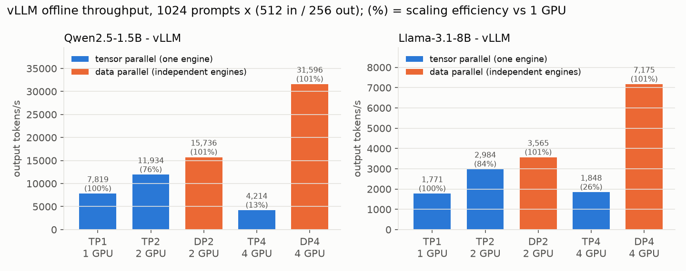

# Multi-GPU Benchmark Report - Stage 1 (RTX A6000)

**Historical report, superseded by [the corrected interpretation](../CURRENT_REPORT.md).** Tables retain the original dataset. Causal explanations, physical-fit assertions, inference telemetry scope and precision equivalence must be read with the corrections; they are not validated by this snapshot. [Remediation (2026/10), [status](../../../docs/SCIENTIFIC_STATUS.md)]

_Generated by `scripts/make_report.py` from `results/`. Every number below is a median over the repeated runs listed in the Runs column; per-run data is in `results/runs.csv` and `results/raw/`._

## Environment

- Host `A6000_NODE`, Linux 7.0.0-38-generic, NVIDIA driver 580.178.04
- GPUs: NVIDIA RTX A6000 (48 GiB), runs used physical GPUs 4-7 only
- Python 3.12.3, PyTorch 2.11.0 (CUDA 13.0, NCCL 2.28.9), DeepSpeed 0.19.7, vLLM 0.26.0, transformers 5.19.0, torchvision 0.26.0

Runs recorded: 208 (ok: 153, skipped_infeasible: 51, failed: 2, oom: 2), by experiment:

| Experiment | Purpose | ok | skipped_infeasible | oom | failed |
|---|---|---:|---:|---:|---:|
| `smoke` | plumbing check, 1/2/4 GPUs | 27 | 0 | 0 | 0 |
| `probe_1gpu` | micro-batch / precision selection | 10 | 0 | 2 | 0 |
| `probe_4gpu` | Llama-8B micro-batch fit | 2 | 0 | 0 | 0 |
| `vllm_smoke` | vLLM plumbing check | 3 | 0 | 0 | 0 |
| `nccl` | interconnect bandwidth | 2 | 0 | 0 | 1 |
| `nccl_diag` | PCIe P2P diagnosis | 3 | 0 | 0 | 1 |
| `train_scaling` | training results (this report) | 84 | 51 | 0 | 0 |
| `vllm_tp4_diag` | vLLM TP=4 diagnosis | 2 | 0 | 0 | 0 |
| `vllm_scaling` | inference results (this report) | 20 | 0 | 0 | 0 |

The two `failed` runs are the default-settings all-reduce on GPUs 4+6 (the PCIe peer-to-peer hang described below; once in `nccl`, once with debug logging in `nccl_diag`). The two `oom` runs are batch-size probes that set the per-GPU micro-batch. `skipped_infeasible` configurations were recorded without being launched.

## Interconnect: NCCL all-reduce bus bandwidth (GB/s)

| GPUs (setting) | Links | 1 MiB | 4 MiB | 16 MiB | 64 MiB | 256 MiB | 1024 MiB |
|---|---|---:|---:|---:|---:|---:|---:|
| 4-5-6-7 (default) | NODE NV4 | 6.7 | 7.4 | 6.6 | 6.3 | 13.0 | 12.3 |
| 4-5 (default) | NV4 | 13.6 | 28.8 | 37.5 | 40.3 | 43.4 | 45.3 |
| 4-5-6-7 (P2P on NVLink only) | NODE NV4 | 6.6 | 7.3 | 6.6 | 6.3 | 13.1 | 12.4 |
| 4-6 (P2P disabled (SHM)) | NODE | 4.2 | 5.0 | 5.2 | 5.3 | 5.4 | 5.5 |

**PCIe peer-to-peer between the NVLink pairs does not work on this node.** A 2-rank all-reduce on GPUs 4+6 (link `NODE`) with default settings never completes its first collective: NCCL picks `P2P/CUMEM` over PCIe for that pair (`NCCL_DEBUG=INFO`, `results/raw/nccl_diag/`), and the NCCL watchdog aborts it after the 5-min timeout. With `NCCL_P2P_DISABLE=1` the same pair works through host memory (`SHM`) at ~5.5 GB/s. For the 4-GPU ring NCCL already uses `P2P/CUMEM` only on the NVLink hops (4-5, 6-7) and `SHM` for the PCIe hops, which is why 4-GPU training needed no change; `NCCL_P2P_LEVEL=NVL` gives the identical transport plan and bandwidth. The likely cause is a host setting (IOMMU/ACS peer-to-peer routing), which is outside the scope of an unprivileged user.

## Training (DDP, FSDP2, DeepSpeed ZeRO)

Weak scaling: fixed per-GPU micro-batch, bf16 compute, AdamW, synthetic data, random init. Throughput is measured over the timed steps after warmup; step time is the slowest rank. Scaling efficiency compares a framework with itself on 1 GPU. MFU uses model FLOPs (6N + 12LdT per token for LMs, counted FLOPs for ResNet-50) against the A6000's 154.8 TFLOPS dense BF16 peak; for Llama-3.1-8B the activation-checkpoint recompute is not counted. Peak memory is the PyTorch caching-allocator reservation (max over ranks).

| Model | Framework | GPUs | Throughput | per GPU | Step (ms) | Scaling eff. | MFU | Peak mem/GPU (GiB) | GPU util | Power/GPU (W) | Runs |
|---|---|---:|---:|---:|---:|---:|---:|---:|---:|---:|---:|
| resnet50 | DDP | 1 | 1,058 img/s | 1,058 | 121.0 | - | 16.6% | 6.8 | 98% | 291 | 3 |
| resnet50 | FSDP2 | 1 | 1,051 img/s | 1,051 | 121.7 | - | 16.5% | 6.8 | 99% | 292 | 3 |
| resnet50 | ZeRO-1 | 1 | 981 img/s | 981 | 130.5 | - | 15.4% | 14.1 | 93% | 284 | 3 |
| resnet50 | ZeRO-2 | 1 | 982 img/s | 982 | 130.4 | - | 15.4% | 14.1 | 94% | 281 | 3 |
| resnet50 | DDP | 2 | 2,096 img/s | 1,048 | 122.1 | 99% | 16.5% | 6.8 | 98% | 291 | 3 |
| resnet50 | FSDP2 | 2 | 2,118 img/s | 1,059 | 120.8 | 101% | 16.6% | 6.6 | 98% | 292 | 3 |
| resnet50 | ZeRO-1 | 2 | 1,948 img/s | 974 | 131.4 | 99% | 15.3% | 14.0 | 96% | 280 | 3 |
| resnet50 | ZeRO-2 | 2 | 1,950 img/s | 975 | 131.3 | 99% | 15.3% | 14.0 | 96% | 281 | 3 |
| resnet50 | DDP | 4 | 3,688 img/s | 922 | 138.8 | 87% | 14.5% | 6.8 | 99% | 284 | 3 |
| resnet50 | FSDP2 | 4 | 3,851 img/s | 963 | 133.0 | 92% | 15.1% | 6.5 | 99% | 289 | 3 |
| resnet50 | ZeRO-1 | 4 | 3,169 img/s | 792 | 161.8 | 81% | 12.4% | 14.0 | 97% | 248 | 3 |
| resnet50 | ZeRO-2 | 4 | 3,167 img/s | 792 | 161.6 | 81% | 12.4% | 14.0 | 96% | 249 | 3 |
| qwen2.5-1.5b | DDP | 1 | 3,992 tok/s | 3,992 | 1,025.3 | - | 25.2% | 38.2 | 99% | 289 | 3 |
| qwen2.5-1.5b | FSDP2 | 1 | 3,553 tok/s | 3,553 | 1,152.5 | - | 22.5% | 35.0 | 92% | 284 | 3 |
| qwen2.5-1.5b | ZeRO-1 | 1 | 4,071 tok/s | 4,071 | 1,006.3 | - | 25.7% | 42.3 | 98% | 278 | 3 |
| qwen2.5-1.5b | ZeRO-2 | 1 | 3,542 tok/s | 3,542 | 1,156.7 | - | 22.4% | 39.7 | 96% | 277 | 3 |
| qwen2.5-1.5b | DDP | 2 | 7,335 tok/s | 3,668 | 1,114.9 | 92% | 23.2% | 38.2 | 99% | 282 | 3 |
| qwen2.5-1.5b | FSDP2 | 2 | 7,034 tok/s | 3,517 | 1,164.2 | 99% | 22.2% | 24.2 | 99% | 285 | 3 |
| qwen2.5-1.5b | ZeRO-1 | 2 | 8,209 tok/s | 4,104 | 997.7 | 101% | 26.0% | 28.8 | 98% | 268 | 3 |
| qwen2.5-1.5b | ZeRO-2 | 2 | 5,579 tok/s | 2,789 | 1,469.2 | 79% | 17.6% | 28.2 | 98% | 252 | 3 |
| qwen2.5-1.5b | DDP | 4 | 7,472 tok/s | 1,868 | 2,193.0 | 47% | 11.8% | 38.2 | 100% | 202 | 3 |
| qwen2.5-1.5b | FSDP2 | 4 | 4,479 tok/s | 1,120 | 3,658.6 | 32% | 7.1% | 18.2 | 100% | 176 | 3 |
| qwen2.5-1.5b | ZeRO-1 | 4 | 8,845 tok/s | 2,211 | 1,852.8 | 54% | 14.0% | 23.3 | 98% | 193 | 3 |
| qwen2.5-1.5b | ZeRO-2 | 4 | 3,998 tok/s | 999 | 4,098.6 | 28% | 6.3% | 21.9 | 99% | 164 | 3 |
| llama3.1-8b | FSDP2 | 4 | 994 tok/s | 249 | 8,241.4 | - | 7.5% | 43.3 | 100% | 173 | 3 |
| llama3.1-8b | ZeRO-3 | 4 | 973 tok/s | 243 | 8,429.0 | - | 7.3% | 43.6 | 99% | 181 | 3 |

**Reading these numbers.** (1) The 2-GPU runs use GPUs 4-5, an NVLink pair; the 4-GPU runs join two NVLink pairs over PCIe, whose all-reduce bus bandwidth is ~4x lower (Interconnect section), so the 2 -> 4 GPU step is mostly a test of PCIe communication. (2) NVML `utilization.gpu` stays near 100 % even when ranks are waiting on NCCL (communication kernels count as busy); mean board power is the better stall indicator - see the power column in `results/summary_train.csv`. (3) With gradient accumulation (Qwen: 4 micro-steps per optimizer step), DDP and ZeRO-1 communicate gradients once per optimizer step, while ZeRO-2 reduce-scatters on every micro-step (DeepSpeed `engine.py`: "ZeRO stage >= 2 communicates during non gradient accumulation boundaries as well") and FSDP2 re-gathers parameters for every micro-step's forward and backward.

### Memory feasibility of full training for Llama-3.1-8B (48 GiB per GPU)

Mixed-precision AdamW needs ~16 bytes/parameter of model state (~120 GiB for 8B) before activations. Configurations whose estimated state alone exceeds the 44 GiB cap are recorded, not launched (see `safety.py`).

| Framework | 1 GPU | 2 GPUs | 4 GPUs |
|---|---|---|---|
| DDP | no: states ~120 GiB/GPU | no: states ~120 GiB/GPU | no: states ~120 GiB/GPU |
| FSDP2 | no: states ~120 GiB/GPU | no: states ~60 GiB/GPU | runs: 43.3 GiB peak |
| ZeRO-1 | no: states ~150 GiB/GPU | no: states ~90 GiB/GPU | no: states ~60 GiB/GPU |
| ZeRO-2 | no: states ~150 GiB/GPU | no: states ~82 GiB/GPU | no: states ~49 GiB/GPU |
| ZeRO-3 | no: states ~150 GiB/GPU | no: states ~75 GiB/GPU | runs: 43.6 GiB peak |

**Llama-3.1-8B note (audit re-run):** ZeRO-3 shows ~2 allocator retries per step with default DeepSpeed buffers; FSDP2 shows none. A re-run with more memory headroom reproduced both numbers within 1-2 % (`results/rerun/RERUN_ANALYSIS.md`).

### Ablation: gradient-reduction precision for Llama-3.1-8B

Same runs with bf16 instead of fp32 gradient reduce-scatter (FSDP2 `reduce_dtype`, DeepSpeed `communication_data_type`), which halves the gradient bytes on the wire.

| Model | Framework | GPUs | Variant | Throughput (tok/s) | Step (ms) | vs baseline | Peak mem/GPU (GiB) | Runs |
|---|---|---:|---|---:|---:|---:|---:|---:|
| llama3.1-8b | FSDP2 | 4 | baseline (fp32 reduce) | 994 | 8,241 | 1.00x | 43.3 | 3 |
| llama3.1-8b | FSDP2 | 4 | bf16-reduce | 1,303 | 6,289 | 1.31x | 42.9 | 3 |
| llama3.1-8b | ZeRO-3 | 4 | baseline (fp32 reduce) | 973 | 8,429 | 1.00x | 43.6 | 3 |
| llama3.1-8b | ZeRO-3 | 4 | bf16-reduce | 1,289 | 6,362 | 1.32x | 43.6 | 3 |

## Inference (vLLM)

Strong scaling: the same 1024 requests (512 random prompt tokens, exactly 256 generated tokens, greedy, `ignore_eos`) on every layout. TP = one engine split across GPUs; DP = independent single-GPU engines that each take an equal share of the prompts and start behind a barrier. TP=4 runs use `NCCL_P2P_LEVEL=NVL` (see Interconnect): with default settings vLLM's TP=4 communicator hung in its first decode step (`results/raw/vllm_tp4_diag/`).

| Model | Layout | GPUs | Output tok/s | Total tok/s | Req/s | Output tok/s per GPU | Scaling eff. | GPU util | Runs |
|---|---|---:|---:|---:|---:|---:|---:|---:|---:|
| llama3.1-8b | TP1 | 1 | 1,771 | 5,314 | 6.92 | 1,771 | 100% | 98% | 2 |
| llama3.1-8b | TP2 | 2 | 2,984 | 8,953 | 11.66 | 1,492 | 84% | 96% | 2 |
| llama3.1-8b | DP2 | 2 | 3,565 | 10,696 | 13.93 | 1,783 | 101% | 95% | 2 |
| llama3.1-8b | TP4 | 4 | 1,848 | 5,544 | 7.22 | 462 | 26% | 96% | 2 |
| llama3.1-8b | DP4 | 4 | 7,175 | 21,525 | 28.03 | 1,794 | 101% | 92% | 2 |
| qwen2.5-1.5b | TP1 | 1 | 7,819 | 23,456 | 30.54 | 7,819 | 100% | 91% | 2 |
| qwen2.5-1.5b | TP2 | 2 | 11,934 | 35,801 | 46.62 | 5,967 | 76% | 84% | 2 |
| qwen2.5-1.5b | DP2 | 2 | 15,736 | 47,209 | 61.47 | 7,868 | 101% | 85% | 2 |
| qwen2.5-1.5b | TP4 | 4 | 4,214 | 12,641 | 16.46 | 1,053 | 13% | 93% | 2 |
| qwen2.5-1.5b | DP4 | 4 | 31,596 | 94,788 | 123.42 | 7,899 | 101% | 68% | 2 |

**Audit re-run:** the TP rows above ran at `max_num_seqs=256` per engine, so DP engines together had more concurrency. The README uses TP results re-run with concurrency matched to the GPU count (512 for TP2, 1024 for TP4): Qwen2.5-1.5B 11,811 / 4,993 and Llama-3.1-8B 3,101 / 1,830 output tok/s. Data parallel beats tensor parallel even at matched concurrency (1.15–1.33× on NVLink, 3.9–6.3× across PCIe). See `results/rerun/RERUN_ANALYSIS.md`.

